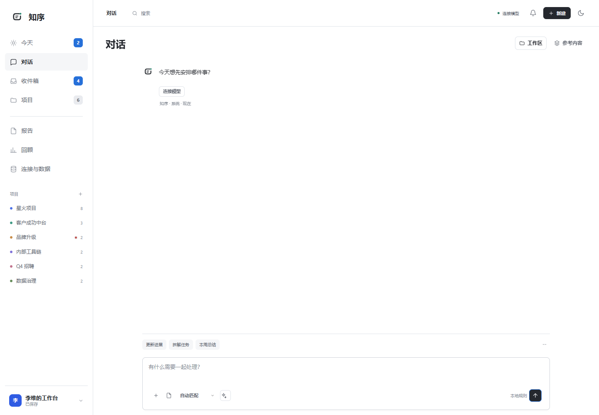

# 知序（ZHIXU）

<p align="center">
  
</p>

<p align="center">
  <strong>把 AI 对话变成可执行的个人工作流。</strong><br>
  在一个本机工作台里连接项目、任务、文档、报告与工具。
</p>

<p align="center">
  <a href="https://github.com/HULI-J/ZHIXU/releases/latest"></a>
  <a href="https://github.com/HULI-J/ZHIXU/stargazers"></a>
  
  
  
</p>

<p align="center">
  <a href="https://github.com/HULI-J/ZHIXU/releases/latest"><strong>下载最新版</strong></a>
  · <a href="docs/26-知序操作手册.md">操作手册</a>
  · <a href="docs/27-异地访问说明.md">异地访问</a>
  · <a href="docs/17-插件安装与管理.md">插件指南</a>
  · <a href="https://github.com/HULI-J/ZHIXU/issues">反馈问题</a>
</p>

<p align="center">
  
  <br><sub>对话可以读取有限的项目上下文，并把确认后的结果写回任务和项目。</sub>
</p>

知序是面向个人工作的 Windows 桌面工作台。它把自然语言对话放在工作流入口，把模型能理解的上下文限制在当前项目、任务和附件范围内；模型只生成可核对的草稿，写入任务、风险、项目或报告前需要经过确认。

## 适合什么工作

知序适合需要同时处理沟通、项目推进和资料整理的人：

- 从邮件、会议、聊天或手动记录中捕获事项，再确认归属和截止日期。
- 围绕项目查看任务、里程碑、风险、等待事项和进展备注。
- 上传 Word、Excel、PDF、PowerPoint 或文本资料，提取内容后整理成可修改的任务草稿。
- 用日报、周报、月报和项目状态报告回顾已经发生的工作。
- 在同一个工作区访问本机文件、网页、PowerShell 终端和受控插件。

## 功能一览

### 对话与模型

- 接入 OpenAI 兼容接口、DeepSeek 或自定义供应商，使用当前选定模型真实问答。
- 对话可使用有限的项目、任务和附件上下文；未提供的数据不会被当成事实补全。
- 任务、风险和新项目先生成待确认草稿，确认后才写入本机工作数据。
- 长对话会整理本机交接摘要，同时保留完整原文，可继续查看更早消息。
- 明确陈述的工作进展可以同步到实际任务和项目，并保留原话、来源和时间。

### 项目与任务

- 项目台账、独立颜色、干系人、里程碑、风险和进展记录。
- 任务捕获、改期、截止日期、优先级、预计工时、计时、状态和备注。
- 逾期、等待、收件箱和回收站支持归档、恢复与清理。
- 删除项目时保留关联任务并解除项目关系；失效项目不会回退显示成另一个项目。

### 文档与报告

- 批量上传 DOC、DOCX、XLSX、PDF、PPTX、TXT、Markdown、CSV，单文件上限 50 MB。
- 先保存原文件，再提取正文；解析失败时保留原文件和失败原因。
- 分析结果可以归档到已有项目、拆解为任务，或保留为待确认的新项目草稿。
- 支持日报、周报、月报、项目状态、风险分析和需求清单，并可导出 Markdown、Word、Excel、PDF。

### 工作区与扩展

- 本机文件夹、文本和图片预览，系统打开文件，原生网页视图和 PowerShell 终端。
- 插件来源支持 npm、公开 GitHub 仓库和本地目录，可连接 MCP 服务。
- 连接器支持飞书、钉钉、企业微信、IMAP 和 ICS；导入前保留来源和身份信息。

### 数据与访问

- 工作数据使用本机 SQLite 存储，附件单独保存。
- 模型 Key、连接器凭据和插件环境变量使用 Windows 安全存储加密。
- 可选 HTTPS 网页访问：浏览器登录主机上的同一份工作数据，不提供独立云端账号或云同步。
- 应用可以匿名检查并后台下载公开 GitHub Release；安装更新仍需要用户确认。

## 快速开始

1. 从 [GitHub Releases](https://github.com/HULI-J/ZHIXU/releases/latest) 下载 Windows 安装包，安装后打开桌面“知序”。
2. 在“设置 → 模型与供应商”中配置一个 OpenAI 兼容接口、DeepSeek 或本地规则模式。
3. 新建一个项目，或先在对话中输入需要处理的事项。
4. 上传文档时选择已有项目，或保留为待确认草稿；确认后再写入任务。
5. 在“今天”“项目”“报告”之间切换，检查待办、风险和下一节点。

安装包不需要另外安装 Node.js 或 Python。工作数据默认保存在当前 Windows 用户的 `%APPDATA%\Zhixu\`；升级时若检测到旧版 `%APPDATA%\Xiaoyu\`，会先复制到新目录，旧目录仍保留作为备份。也可以在设置中选择其他本机文件夹。

`0.2.17` 起统一使用知序 / Zhixu 命名；已有自定义数据位置和安装位置继续沿用。数据库文件仍名为 `workbench.sqlite`，不需要手动修改数据库或重建工作台。

## 隐私边界

- 默认不使用知序自有云端后端；项目、任务、聊天记录、附件和配置留在本机。
- 只有在发起模型请求时，当前问题、选定的上下文和必要附件内容才会发送到你配置的供应商。
- 网页访问复用主机数据，使用密码和有期限的会话；主机 Key 不会下发到浏览器。
- 仓库不包含用户数据库、附件、日志秘密、API Key 或安装包。
- 如果需要迁移或备份，请先正常退出应用，再复制实际数据文件夹；单独复制 SQLite 不包含附件。

## 已知边界

当前版本尚未包含：

- 模型自动联网搜索和自动执行工作区工具。
- 扫描件 OCR、旧版二进制 XLS/PPT 的完整解析。
- 云端账号、云同步、离线合并和固定公网地址托管。
- 任意宿主插件的完全兼容。

网页访问是对本机工作台的浏览器入口，不是独立的远程 SaaS 服务。终端、插件和任意本机目录能力仍在桌面端使用。

## 文档

- [知序操作手册](docs/26-知序操作手册.md)：首次配置、项目与任务、文档分析、报告、插件和备份。
- [异地访问说明](docs/27-异地访问说明.md)：开启 HTTPS 网页入口、跨设备使用和故障排查。
- [插件安装与管理](docs/17-插件安装与管理.md)：插件来源、兼容性、MCP 连接和安全边界。
- [连接器配置与测试](docs/06-连接器配置与测试说明.md)：飞书、钉钉、企业微信、IMAP、ICS 的字段与权限。
- [开源项目与可复用方案调研](docs/04-开源项目与可复用方案调研.md)：产品定位和技术选型参考。
- [发布说明](https://github.com/HULI-J/ZHIXU/releases)：版本变化和安装包。

## 开发

需要 Node.js 24。

```powershell
npm install
npm run dev          # Electron 桌面开发模式
npm run dev:web      # 浏览器预览
npm run build        # 类型检查与生产构建
npm test             # TypeScript 单元与集成测试
npm run test:desktop # 隔离数据的桌面回归
npm run test:chat    # 对话、模型和确认流程烟测
npm run dist         # 生成 Windows 安装包
```

目录结构：

```text
src/main/       Electron 主进程、数据库、模型与系统能力
src/renderer/   React 渲染入口
src/shared/     主进程与界面共享的数据契约
prototype/      工作台页面、交互和样式
tests/          单元测试与桌面/浏览器回归
docs/           使用手册、设计文档和版本说明
```

修改 `prototype/` 后，`npm run build` 会先同步工作台资源，再生成 Electron 产物。不要直接编辑 `out/`、`desktop-public/` 或 `release/`。

## 反馈与贡献

请通过 [GitHub Issues](https://github.com/HULI-J/ZHIXU/issues) 反馈问题，尽量附上：

- Windows 版本、知序版本和复现步骤。
- 预期结果与实际结果。
- 已脱敏的错误信息或截图。

请不要提交数据库、附件、API Key、网页访问密码、GitHub 凭据或包含个人项目内容的日志。涉及安全问题时，请先通过仓库维护者可见的渠道联系，不要公开发布凭据或可复现的敏感数据。

## 许可证

仓库当前尚未声明开源许可证。代码可以公开阅读和克隆，但在维护者补充许可证前，不应默认拥有再分发、商用或二次修改授权。

---

知序的定位是一个本机优先的个人工作台：让模型帮助你理解和整理工作，同时让每一次写入都能回到真实的项目、任务和原始记录。
